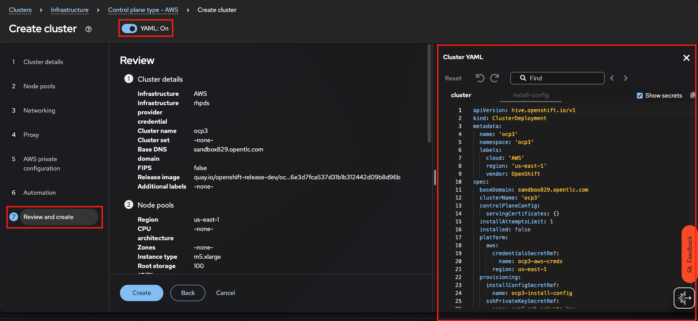
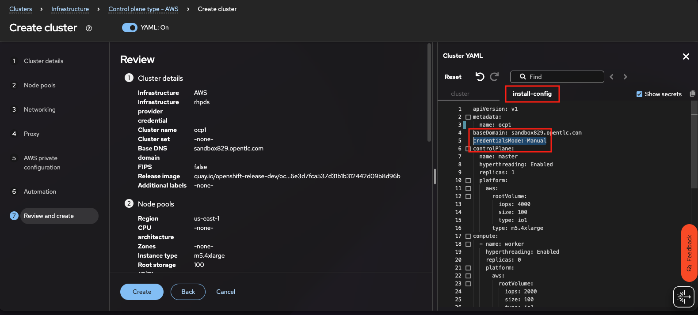
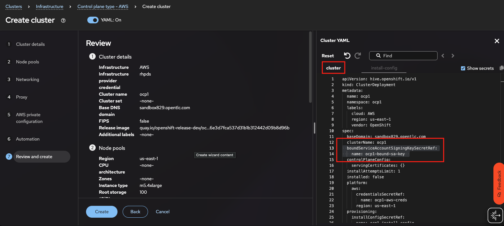
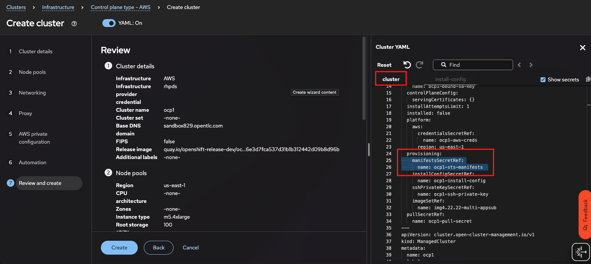
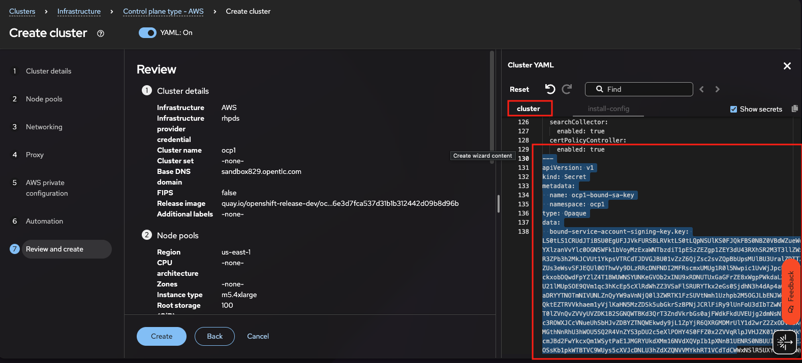
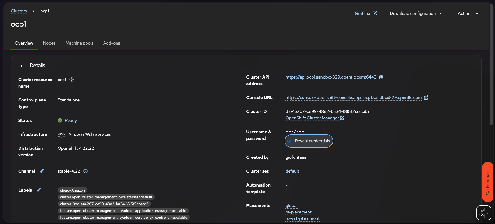
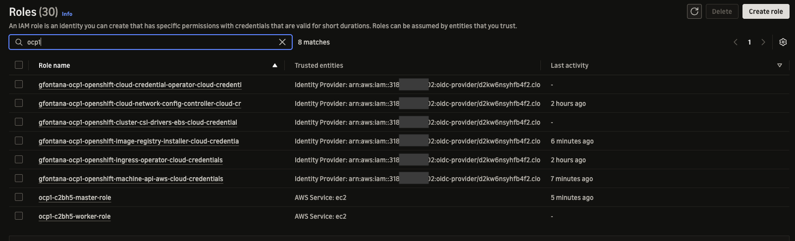

# Deploy an OpenShift Cluster on AWS with STS Using Red Hat ACM

This procedure deploys an OpenShift cluster on AWS from Red Hat ACM using AWS Security Token Service (STS). With STS, in-cluster components use short-lived tokens tied to IAM roles instead of long-lived AWS access keys.

Overview:

1. Create the IAM roles, OIDC provider and manifests with `ccoctl`.
2. Turn the `ccoctl` output into two secrets for the ACM hub.
3. Add the STS settings and secrets to the cluster YAML in the ACM wizard, then create the cluster.

## Prerequisites

- A Linux host (or container) to run `ccoctl`. `ccoctl` is only shipped as a Linux binary.
- `oc` and `openshift-install` for the **same OpenShift version** you will select in the ACM wizard.
- A pull secret (`pull-secret.json`) to extract content from the release image.
- AWS credentials for `ccoctl` with permissions to create IAM roles, an IAM OIDC provider, S3 buckets and CloudFront distributions (`--create-private-s3-bucket` uses CloudFront).
- An AWS credential configured in ACM. The installer still uses it to create the cluster infrastructure; STS only applies to cluster components after installation.

## Variables

Set these once and use them in every step. They must match the values entered in the ACM wizard:

```bash
CLUSTER_NAME=ocp1      # Must be exactly the cluster name entered in ACM (also the hub namespace)
CCO_NAME=ocp1          # Prefix for the IAM roles, OIDC provider and S3 bucket created by ccoctl
AWS_REGION=us-east-2   # Must match the region selected in ACM
```

## 1. Provision Cloud Credentials Manifests

Run this step once per cluster.

> **Warning:** It is possible to reuse the same OIDC provider and IAM roles for several clusters, but this is not recommended. Clusters that share the signing key trust each other's service account tokens: a service account in one cluster can assume the IAM roles of the others, because the role trust policy only checks the namespace and service account name. If you reuse the output anyway, you still need to create the secrets from step 2 in each cluster's namespace.

1.1. Download `openshift-install` and `oc` for the target OpenShift version, then extract `ccoctl` from the same release image:

```bash
RELEASE_IMAGE=$(./openshift-install version | awk '/release image/ {print $3}')
oc adm release extract --command=ccoctl --from=$RELEASE_IMAGE -a pull-secret.json --to=.
chmod +x ccoctl
```

1.2. Prepare an `install-config.yaml`. It is only used to filter which credential requests apply, and nothing is created from it. It must use platform `aws`, the same region (`${AWS_REGION}`) and the same capabilities as the cluster you will create in ACM.

1.3. Extract the credential requests and run `ccoctl`:

```bash
mkdir creds-reqs
oc adm release extract \
  --from=$RELEASE_IMAGE \
  -a pull-secret.json \
  --credentials-requests \
  --included \
  --install-config=./install-config.yaml \
  --to=./creds-reqs

mkdir cco-output
./ccoctl aws create-all \
  --name=${CCO_NAME} \
  --region=${AWS_REGION} \
  --credentials-requests-dir=./creds-reqs \
  --output-dir=./cco-output \
  --create-private-s3-bucket
```

## 2. Generate the Secrets for RH ACM

2.1. Create the secret YAMLs from the `ccoctl` output:

```bash
cd cco-output

# Signing key secret
oc create secret generic ${CLUSTER_NAME}-bound-sa-key \
  -n ${CLUSTER_NAME} \
  --from-file=bound-service-account-signing-key.key=tls/bound-service-account-signing-key.key \
  --dry-run=client -o yaml > bound-sa-key.yaml

# STS manifests secret (one key per file)
oc create secret generic ${CLUSTER_NAME}-sts-manifests \
  -n ${CLUSTER_NAME} \
  --from-file=manifests/ \
  --dry-run=client -o yaml > sts-manifests.yaml
```

2.2. Print both secrets and copy the output. You will paste it in the ACM wizard in step 3.5:

```bash
cat bound-sa-key.yaml; echo '---'; cat sts-manifests.yaml
```

> **Security:** `tls/bound-service-account-signing-key.key` and `bound-sa-key.yaml` contain the cluster's private service account signing key. Store them securely, or delete them once the cluster is deployed.

## 3. Deploy the Cluster from the RH ACM Web Console

3.1. In RH ACM, fill out the cluster creation form, but do **not** click **Create**. Stop at the last step (**Review and create**) and turn on the YAML view.



3.2. Select the `install-config` tab and add the following as a top-level field (no indentation):

```YAML
credentialsMode: Manual
```

Example:



3.3. Select the `cluster` tab and add the following under `spec`. Replace `<cluster-name>` with the value of `${CLUSTER_NAME}`:

```YAML
  boundServiceAccountSigningKeySecretRef:
    name: <cluster-name>-bound-sa-key
```

Example:



3.4. In the same `cluster` tab, add the following lines inside the existing `spec.provisioning` block:

```YAML
    manifestsSecretRef:
      name: <cluster-name>-sts-manifests
```

Example:



3.5. Go to the end of the `cluster` tab, add a line with `---`, and paste the output you copied in step 2.2.

Example:



3.6. Click **Create**.

## 4. Verify

The cluster should provision successfully:



The cluster should be using STS:



You can also check from the CLI, logged in to the new cluster:

```bash
oc get cloudcredential cluster -o jsonpath='{.spec.credentialsMode}{"\n"}'     # Expected: Manual
oc get authentication cluster -o jsonpath='{.spec.serviceAccountIssuer}{"\n"}' # Expected: the ccoctl OIDC URL
```

## 5. Clean Up After Destroying the Cluster

Destroying the cluster from ACM does **not** remove the AWS resources created by `ccoctl`. After the cluster is destroyed, remove them:

```bash
ccoctl aws delete --name=${CCO_NAME} --region=${AWS_REGION}
```
